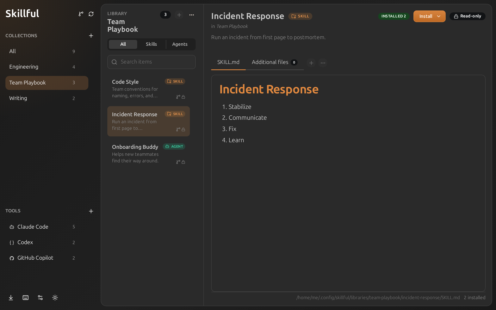
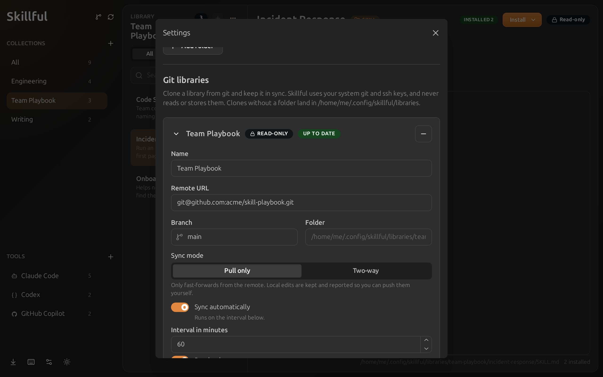
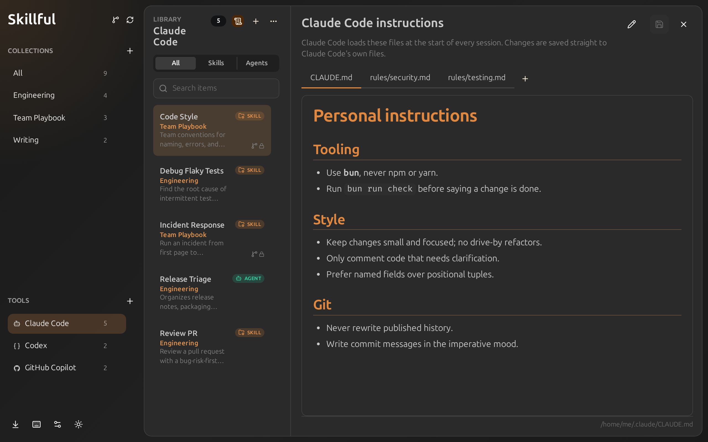
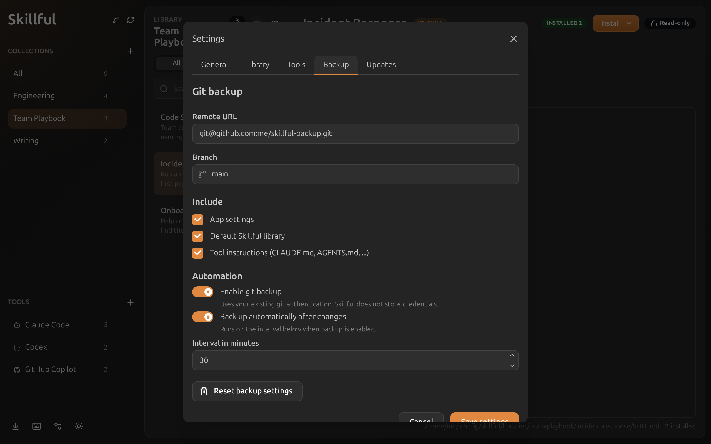

# Changelog

## 1.3.0 - 2026-11-02

### Git libraries

Use a git repository as a skill and agent library. Skillful clones it, keeps it in sync on an interval, and marks where each item came from, so a team can share one playbook while everyone keeps their own library next to it.

- Pull-only sync fast-forwards from the remote and reports local edits; two-way sync also pushes them
- Read-only libraries keep the remote the only author, ideal for shared team playbooks
- Uses your system git and ssh keys; Skillful never reads or stores credentials

### Edit your tools' own instructions

Edit the instructions each tool loads in every session (`CLAUDE.md`, `AGENTS.md`, `GEMINI.md`, `copilot-instructions.md`) right inside Skillful, with the same editor and preview as your skills.

- Open them from the list header while a tool is selected, or from that tool's settings
- Files are edited in place, where the tool reads them; Skillful asks before overwriting changes the tool made itself
- Claude Code's `~/.claude/rules/*.md` files show up as extra tabs, and you can add new ones
- Warns when Codex's `AGENTS.override.md` exists, because Codex then ignores `AGENTS.md`

### Tool instructions in git backups

Git backups can now include those instruction files and restore them on another machine, even on another operating system. This is on by default for new backups and off for backups set up before 1.3.0, so nothing personal starts going to an existing remote without you choosing it.

### Other changes

- Added support for home-relative paths starting with `~/`, also on Windows
- Added security checks to the GitHub importer
- Added a Content Security Policy
- Fixed folders from another OS (e.g. via git backup) breaking settings; they are now skipped and flagged in settings

### Development

- Replaced Biome with oxlint (linting) and oxfmt (formatting)

## 1.2.1 - 2026-06-12

- Fixed packaged app startup failure caused by missing runtime icon assets.

## 1.2.0 - 2026-06-11

- Added git backup
  - Added restore from git
- Added tray icon with "minimize to tray" behaviour

- fixed filesystem watcher also watching chromium files
- fixed filesystem watcher looping on the cache files
- improved look on Mac OS with inset header. [view](./docs/images/mac-os.png)

## 1.1.2 - 2026-05-13

- Fixed not being able to select a new collection while moving items, fixes [#1](https://github.com/Mastermindzh/skillful/issues/1)
- _DEV:_ added devcontainer

## 1.1.1 - 2026-05-11

- Disabled AppImage sandbox
- Added discord icon to README
- Fixed Windows updater
- Fixed AUR deployment (hopefully... 'works on my machine')

## 1.1.0 - 2026-05-11

- Added a joyride to teach the user how to use the app

## 1.0.0 - 2026-05-10

First stable release.

### Added

- Local-first skill and agent library management using folders on disk.
- Collection creation, rename, delete, move, import, and export workflows.
- Folder import, `.skillful.zip` archive import/export, and GitHub source archive import.
- `skillful://import` deep links for repository README import buttons.
- Markdown preview and edit modes with a configurable default editor mode.
- Additional file management for screenshots, scripts, references, and other supporting assets.
- Frontmatter metadata validation for entry files with non-blocking warnings.
- Tool install, remove, and repair flows for Claude Code, Codex, GitHub Copilot, Cursor, Gemini CLI, Junie, and opencode-style destinations.
- Large-library search and filtering by collection, tool, and item kind.
- English and Dutch UI localization foundation.
- Cross-platform Electron packaging for Windows, macOS, and Linux.

### Notes

- Skillful is source-available under FSL-1.1-MIT.
- Windows and macOS builds are unsigned for now. See [docs/install.md](docs/install.md) for first-launch instructions.
- Package-managed Linux installs should be updated through the same package manager or store used for installation.
